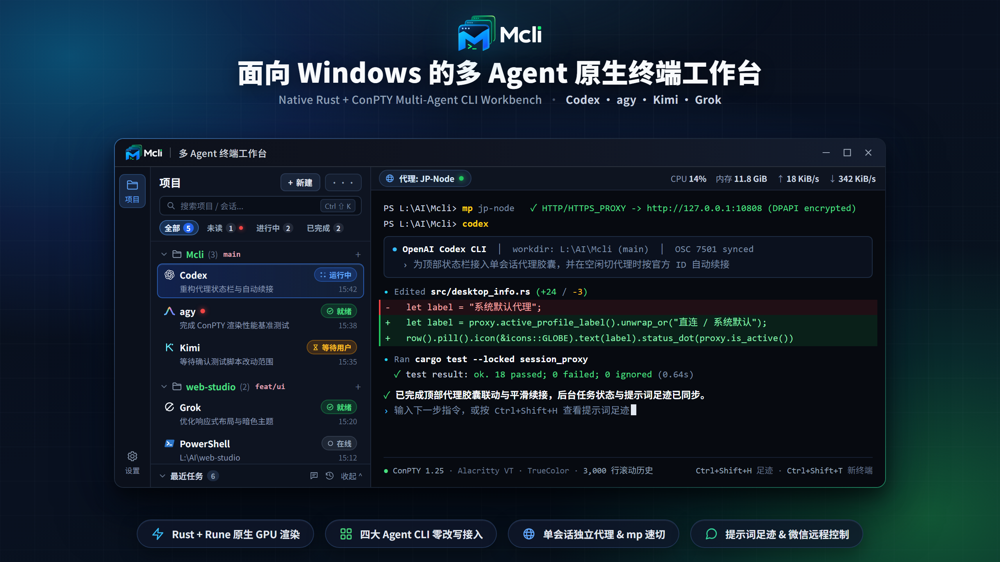

# Mcli

[English](README.en.md) | **简体中文**



Mcli 是一款面向 Windows 的原生多 Agent CLI 桌面终端工作台，使用 Rust 与 Rune 构建。

一个窗口可以同时运行多个相互独立的 PowerShell 会话，左侧按工作目录与 Git 分支自动归组，右侧呈现原生 ConPTY + GPU 渲染的终端网格。无需修改命令行参数，也不必为项目配置钩子，直接输入 `codex`、`agy`、`kimi` 或 `grok` 即可无缝接入状态追踪、后台未读提醒、最近任务与提示词足迹。

---

## 核心特性

- **原生多会话终端工作台**
  - 按 Shell 报告的真实工作目录自动归组，显示项目会话数与当前 Git 分支（或分离 HEAD 短提交号）；右键项目名打开自绘深色菜单，支持在资源管理器中打开目录、新建终端、复制路径以及一键展开/折叠全部项目目录。
  - 默认每用户会话单实例运行，重复启动 `mcli.exe` 自动唤醒并前置已有窗口（包括最小化到托盘的窗口）。
  - 切换会话时保留各终端的未提交草稿与最多 3,000 行滚动历史；后台会话持续运行不中断。
  - 支持 16 色、256 色与 RGB 真彩，支持中文输入法（IME）、文本拖选、图片与多文件拖拽/粘贴（`Ctrl+V` / `Shift+Insert`）。
- **零改写适配 4 款主流 Agent CLI**
  - 原生识别 **OpenAI Codex CLI（`codex`）**、**Antigravity CLI（`agy`）**、**Kimi Code CLI（`kimi`）** 与 **Grok Build CLI（`grok`）**，不注入、不改写任何用户输入参数。
  - 通过原生 `OSC 7501`（含 Kimi 子 Agent 状态聚合）与 `OSC 0` 标题状态精准展示「运行中」「等待用户」「就绪」「出错」状态；后台会话完成回复后自动点亮未读红点，切回即清除。
- **最近任务、提示词足迹与自动续接**
  - 自动发现当前目录及子目录的官方历史对话（仅只读访问官方记录文件），支持在右侧浮层抽屉查看、搜索和复制整段提问原文，开关抽屉不改变终端列宽和现有选区。
  - 在同一 Codex 终端执行 `/clear` 或 `/new` 后，会话树和已打开的提示词抽屉会跟随新对话。新会话身份尚未确认时，旧内容会先清空，等本终端的提问与一份官方记录唯一对应后再显示。旧对话仍可从「全部历史」打开。
  - 同一项目打开多个 Codex 终端时，缺少官方 ID 的新终端会等本终端的提问与一份新建官方记录唯一对应后，再显示该会话的侧栏摘要。
  - 正常关闭窗口后自动保存工作台布局与会话代理，下次启动按官方对话 ID 续接；支持网络闪断自动重试（最多 3 次，可按 `Ctrl+C` 取消）。
- **多代理预设与一键切换（桌面 + Shell `mp` + 自动默认）**
  - 每个终端独立记录对 `HTTP_PROXY`、`HTTPS_PROXY`、`ALL_PROXY`、`NO_PROXY` 的修改与移除，同一项目的不同终端可使用不同代理；代理记录使用 Windows DPAPI 按当前用户加密保存在本地。
  - 在「设置 -> 代理预设」中可管理多套代理环境（支持仅填端口号如 `10808` 自动补全），设定新终端全局默认代理与按 `Codex` / `agy` / `Kimi` / `Grok` 自动默认代理（手动切换永远优先）。
  - 支持点击顶部状态栏「代理」胶囊一键切换（Agent 空闲时按原官方对话 ID 平滑重开续接），或在 PowerShell 内使用极短命令 `mp <预设名|编号|off|sys>` 即时生效。
- **微信 ClawBot 远程控制（默认关闭，按需开启）**
  - 可在「设置」页扫码绑定微信 ClawBot，凭据经 Windows DPAPI 加密存盘，严格单账号白名单校验，无额外第三方异步运行时依赖。
  - 支持 `/list`、`/use`、`/status`、`/last`（`/r` 读取干净完整最新回复或最近 2-5 轮对话）、`/proxy`、`/new`、`/reopen`、`/screen`、`/stop`、`/approve`、`/deny`、`/key`、`/more`、`/ping` 及默认关闭的 `/sh`；支持 24 小时令牌到期前 3/2/1 小时主动保活提醒与重启离线消息保护。
- **任务完成提示音与可定制工作台**
  - Agent 回复完成或进入「等待用户」审批时播放 Windows 系统提示音（默认仅在窗口失焦或非当前会话时提醒并带 1.5 秒防抖，支持在设置页切换 Terminal 同款 / 系统通知 / 消息提示音效与一键试听；动态加载系统音频 API，尊重系统静音并在精简环境安全降级）。
  - 在「设置」页支持开关 **关闭时最小化到托盘**（左键托盘图标恢复窗口，右键菜单可显示或彻底退出）、开关 **顶部整机状态栏**（代理切换胶囊 + CPU / 内存 / 网速监控），以及 **自定义全部全局快捷键**。

---

## 系统要求

- **操作系统**：Windows 10 1809（Build 17763）64 位及以上（推荐 Windows 10 22H2 或 Windows 11 64 位）。
- **Shell**：优先使用 PowerShell 7（`pwsh.exe`），未安装时自动回退至 Windows 自带的 Windows PowerShell 5.1（无需额外安装依赖）。
- **Agent CLI（按需安装）**：需在本机 PATH 中已安装对应官方 CLI（`codex`、`agy`、`kimi` 或 `grok`）。

---

## 快速开始（直接运行预构建版）

1. 前往本仓库的 [Releases 页面](https://github.com/ab0029/Mcli/releases) 下载最新的 `mcli-v*-windows-x64.zip`。
2. 解压到任意本地目录，保持 `mcli.exe` 与 `conpty/` 目录位于同一文件夹下：
   ```text
   mcli/
   ├── mcli.exe
   ├── mcli-hook.exe          # 可选事件钩子转发器，日常使用无需手动运行
   └── conpty/                # 随附的微软签名 ConPTY 组件
   ```
3. 双击 `mcli.exe` 启动，在终端里切换到项目目录后直接启动您常用的 CLI：
   ```powershell
   cd 'C:\path\to\your-project'
   codex    # 或 agy / kimi / grok
   ```
4. 输入 `/exit` 返回原 PowerShell；输入 `exit` 结束当前终端后可点击「↻」原目录重开。

---

## 默认快捷键

以下全局快捷键均可在左侧导航的「设置」页中点击重新录制或一键恢复默认：

| 默认快捷键 | 功能 |
| --- | --- |
| `Ctrl+Shift+K` | 定位到项目与会话搜索框 |
| `Ctrl+Shift+H` | 打开或收起当前对话的「提示词足迹」浮层抽屉 |
| `Ctrl+Shift+L` | 打开或收起「全部历史」列表 |
| `Ctrl+Shift+T` | 在当前目录新建 PowerShell 会话 |
| `Ctrl+PageUp` | 切换到上一个终端会话 |
| `Ctrl+PageDown` | 切换到下一个终端会话 |

**局部固定快捷键**：

- 搜索框或抽屉内按 `Esc`：清除搜索 / 收起抽屉并返回终端。
- 足迹抽屉内按 `Ctrl+F`：聚焦足迹全文搜索框。
- 终端内有选区时按 `Ctrl+C` 复制，无选区时发送中断信号；`Ctrl+V` 或 `Shift+Insert` 粘贴文本、图片或文件；CLI 接管鼠标时按住 `Shift` 可强制拖选文本。

---

## 本地数据与隐私

Mcli 所有状态均仅保存在本机，不向任何第三方服务器上传对话内容：

- 工作台快照：`%LOCALAPPDATA%\Mcli\workspaces\`
- 本地足迹索引：`%LOCALAPPDATA%\Mcli\conversations.sqlite3`
- 偏好、代理预设与快捷键：`%LOCALAPPDATA%\Mcli\preferences.json`、`%LOCALAPPDATA%\Mcli\proxy-profiles.json`
- 微信 ClawBot 加密凭据（仅启用后生成）：`%LOCALAPPDATA%\Mcli\clawbot-auth.bin`（Windows DPAPI 当前用户加密）
- 官方对话读取：仅以只读方式读取各官方 CLI 的本地日志目录（`~/.codex`、`~/.gemini/antigravity`、`~/.kimi-code`、`~/.grok`）。

---

## 开发者指南（从源码构建）

### 环境准备

- Windows x64 + Rust 工具链（Edition 2024，建议使用最新稳定版 Rust）
- 链接环境：
  - **MSVC 工具链**：Visual Studio C++ Build Tools + Windows SDK（含 `rc.exe`）
  - **GNU 工具链**：MinGW-w64（PATH 中包含 `as`、`dlltool`、`windres`）

### 构建与准备 ConPTY

```powershell
# 1. 构建 Release 可执行文件
cargo build --release --locked

# 2. 准备微软签名的 Windows x64 ConPTY 组件到 target/release/conpty/
.\scripts\prepare-conpty.ps1
```

构建完成后直接运行 `target\release\mcli.exe`。如果缺失 `conpty/` 目录，Mcli 会自动回退到 Windows 系统内置的 ConPTY 实现。

### 运行测试与代码检查

```powershell
cargo fmt --check
cargo test --locked
```

> 说明：带 `official_*` 前缀的用例标记为 `#[ignore]`，用于连接真实已登录的官方 CLI 进行在线集成验证，默认 `cargo test` 不会触发。

### 目录结构

```text
src/
├── main.rs                 # 应用入口、键盘/IME/剪贴板路由与界面装配
├── single_instance.rs      # Windows 单实例控制与重复启动唤醒前置
├── workspace.rs            # 多标签会话管理、状态汇总、窗口标题与恢复
├── workbench.rs            # 侧栏宽度、设置持久化、快捷键录制与自绘深色浮层菜单
├── sidebar.rs              # 左侧项目树、会话行、目录右键操作与图标绘制
├── sidebar/navigation.rs   # 导航栏、搜索筛选与「设置」页 UI
├── tray.rs                 # Windows 原生系统托盘与右键菜单
├── sound.rs                # 后台线程动态加载系统音频 API 与任务完成提示音
├── clawbot.rs / clawbot/*  # 可选微信 ClawBot 远程控制（WinHTTP 长轮询 + DPAPI 存储 + 指令路由）
├── terminal.rs             # 终端会话生命周期、读写线程与屏幕状态监测
├── terminal_view.rs        # Alacritty 网格到 Rune 渲染层的映射与缓存
├── pty.rs / pty/conpty.rs  # Windows ConPTY 封装与随附组件哈希校验
├── shell.rs                # PowerShell 探测、OSC 7501/0/9/633 协议解析
├── discovery.rs            # Codex / agy / Kimi / Grok 历史会话发现
├── transcript.rs           # 各厂商官方记录只读适配器
├── history.rs              # 后台对话归属、被动绑定与增量同步服务
├── conversation_store.rs   # 本机 SQLite 足迹索引与分页搜索
├── proxy.rs                # Windows DPAPI 单标签加密代理与多环境预设存储
├── desktop_info.rs         # 后台整机指标采样、顶部代理切换栏与 Git 分支检测
└── bin/mcli-hook.rs        # 可选的项目钩子事件转发器
```

---

## 开源协议

本项目基于 [MIT License](LICENSE) 开源。

随附的微软 ConPTY 组件遵循其原有许可协议，详见 [Microsoft.Windows.Console.ConPTY.txt](doc/licenses/Microsoft.Windows.Console.ConPTY.txt)。
